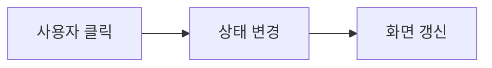

# B1-2 · 00단계 | 쉽고 작은 학습부터 시작하기

> **00단계: PLAN_ONLY** · **01 공식 요구: NOT_STARTED** · **새 코드: NOT_STARTED / 승인 PENDING** · **실행·학습 성취: NOT_VERIFIED**

**30초 요약:** 이 미션은 **React로 화면이 바뀌는 웹앱**에 대해 배웁니다. 첫 번째 용어는 <mark>상태(State)</mark>입니다. **개념 하나 → 그림 하나 → 질문 하나**를 이해한 후 다음으로 넘어가면 됩니다.

## 00단계의 4개 학습 영역

| 영역 | 바로가기 |
|---|---|
| A. 처음 시작하기 | [시작](#b12-00-start) |
| B. 기술 배우기 | [첫 개념·Mermaid](#b12-00-learn) |
| C. 진행 확인하기 | [현재 상태](#b12-00-status) |
| D. 상세 참고자료 | [더 알아보기](#b12-00-more) |

## A. 처음 시작하기

**무엇을 배우나요?** React로 화면이 바뀌는 웹앱. 공식 필수 요구사항은 **01단계**에서 평가표 원문과 연결합니다.

**아래에서 한 가지 출발점을 선택하세요.**

- 처음 배우기 → 아래 **B. 기술 배우기**
- 전체 개념도·기술 용어 미리보기 → [기술 학습 개요](TECHNICAL-LEARNING-OUTLINE.md)
- 현재 진행 상태만 확인 → 아래 **C. 진행 확인하기**

## B. 기술 배우기 — 오늘은 한 개념만

### 오늘의 용어: 상태(State)

화면에 영향을 주는 데이터입니다. 버튼을 누른 횟수를 상태에 저장하면 React가 화면을 갱신할 수 있습니다.

**그림으로 보기 (교육용 개념도):**

**생각할 질문:** 카운터 숫자가 0에서 1로 바뀔 때 변화한 것은?

**답과 이유:** 카운터의 상태(State) 값입니다.

### 내 말로 설명·종이 재현 (Teach-back / Dry-run)

**두 문장으로 설명해 보세요.** 상태(State)는 화면 표시를 결정하는 값입니다. 이용자가 버튼을 누르면 상태가 바뀌고 React가 변경된 화면을 그릴 수 있습니다.

**종이에 실행 과정을 따라 그려 보세요.**

1. 입력: 사용자가 카운트 버튼을 누름.
2. 처리: 이벤트 처리 함수가 상태를 갱신.
3. 예상 결과: 화면에 예상 숫자가 표시됨.

**자주 헷갈리는 부분:** 상태를 직접 바꾼다고 React 렌더링이 항상 올바르게 일어나는 것은 아닙니다. React에서 권장하는 상태 갱신 방식을 사용해야 합니다.

<ins>이 활동은 실제 코드를 실행한 결과가 아닌 교육용 예상 흐름입니다.</ins> 심화 용어와 평가 질문은 [한글·영어·약어 용어표](TECHNICAL-LEARNING-OUTLINE.md)에서 확인하세요.

다음 개념은 [B1-2 기술 학습 9요소](TECHNICAL-LEARNING-OUTLINE.md)에서 하나씩 확인하세요. 전체 학습 흐름은 **용어 → 개념 → 비유 → 아키텍처 → 주요 코드 → 실행 흐름 → 오류 해결 → 실습 → 평가**입니다.

<ins>위 그림은 실제 신규 코드나 시험 결과가 아닙니다. 신규 설계는 03단계, 구현은 별도 승인 후 04단계입니다.</ins>

## C. 진행 확인하기

| 구분 | 상태 |
|---|---|
| **00단계 교육·계획 개요** | PLAN_ONLY — 문서 작성 |
| **01단계 공식 요구 분석** | NOT_STARTED |
| **03단계 상세 설계** | NOT_STARTED |
| **04단계 신규 코드** | NOT_STARTED / 승인 PENDING |
| **실제 실행·슬라이드·학습자 숙달** | NOT_VERIFIED 또는 NOT_STARTED |

**중요:** 계획/자료 반영 PASS와 **미션 기능 PASS·학습자 MASTER**는 다릅니다. 이전 Round의 결과는 보존합니다.

## D. 상세 참고자료

| 더 알고 싶은 내용 | 문서 |
|---|---|
| 용어·아키텍처·학습 예정 코드 | [기술 학습 개요](TECHNICAL-LEARNING-OUTLINE.md) |
| PRIMM·AI 힌트·L1~L5 평가 계획 | [학습체계 계획](LEARNING-SYSTEM-PLAN.md) |
| 발표·학습·심화·복습 4종 자료 | [슬라이드 계획](SLIDE-PACKAGE-PLAN.md) |
| 후속 개발단계 | [01 요구](../01-requirements/README.md) · [02 분석](../02-analysis/README.md) · [03 설계](../03-design/README.md) |
| 전체 공통 교육 규칙 | [중앙 학습 표준](https://github.com/MetaStudy999/codyssey-basic/blob/main/standards/LEARNER-CENTERED-AI-LEARNING-STANDARD.md) |

**다음 단계:** 공식 미션 PDF 및 평가표를 확인하는 01단계입니다. 새로운 코드 개발·실행은 아직 승인되지 않았습니다.

---

## 기존 00단계 계획·승인 기록 (원문 보존)

**기존 제목:** B1-2 — 계획 및 승인

공식 요구·기존 구현·미완료 항목을 조사하고 목차·일정을 사용자와 협의합니다. 승인 전 개발 금지. 현재 PLAN_ONLY.

## 후속 구획

- [01 공식 요구사항](../01-requirements/README.md)
- [02 기존 분석](../02-analysis/README.md)
- [03 신규 설계](../03-design/README.md)

본 폴더는 일정과 승인 관리만 담당하며 신규 구현·검증을 완료했다고 표시하지 않습니다.

## 사용자 승인 4종 슬라이드 계획 (2026-10-26)

- [학습·발표 패키지 전체 계획](SLIDE-PACKAGE-PLAN.md)
- 발표 16장 / 학습 45장 / 기술 부록 15~25장 / 핵심 복습 1~2장.
- 실제 발표자료 및 신규 개발은 별도 단계이며 현 상태는 계획 승인입니다.

## 학습자 중심 AI 교육·학습체계 고도화 (2026-10-26 승인)

[학습체계 최종 계획](LEARNING-SYSTEM-PLAN.md) · 16가지 기법(M01~M16), PRIMM, AI 힌트 H1~H4, L1~L5 숙달, 8개 품질 게이트(QG-01~08), 사전·사후 평가·간격 복습을 단계별 작업으로 추가합니다. 신규 코드·교육자료·학습자 평가는 아직 미실시입니다.

## 기술 학습 9요소 — 입문자용 개요 (2026-10-26)

[B1-2 기술 용어·개념·Mermaid 개념 아키텍처·주요 코드·실습·평가 안내](TECHNICAL-LEARNING-OUTLINE.md). **용어 → 개념 → 비유 → 아키텍처 → 주요 코드 → 실행 흐름 → 오류 해결 → 실습 → 평가**를 이번 미션 기술에 맞춰 적용합니다.

현재는 **PLAN_ONLY**이며 실제 신규 구현·실행·학습자 평가 **NOT_STARTED / NOT_VERIFIED**, 개발 승인 **PENDING**은 유지합니다.
