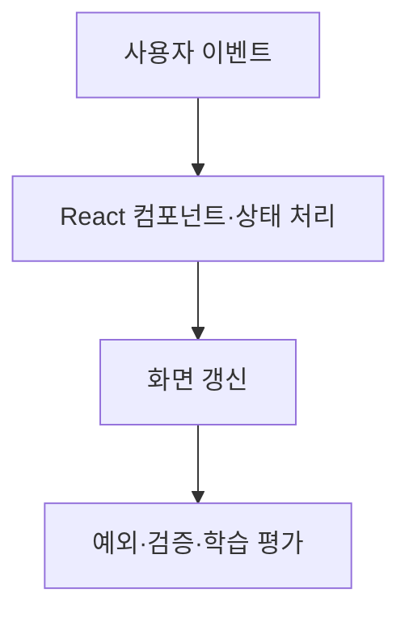

# B1-2 — 기술 학습 9요소 개요

> **PLAN_ONLY / NOT_VERIFIED.** React 단일 페이지 앱 분야의 용어·개념·아키텍처·주요 코드 학습을 위한 준비 문서입니다. 00단계 교육 계획과 실제 코드·실습 증빙을 혼동하지 않습니다.

## 1. 용어·개념 미리보기

| 순서 | 먼저 배울 기술 용어 | 이후 확인할 내용 |
|---|---|---|
| 1 | **Component** | 한글·영어 정의, 역할, 필요성, 예제, 반례 |
| 2 | **JSX** | 한글·영어 정의, 역할, 필요성, 예제, 반례 |
| 3 | **Props** | 한글·영어 정의, 역할, 필요성, 예제, 반례 |
| 4 | **State** | 한글·영어 정의, 역할, 필요성, 예제, 반례 |
| 5 | **Event** | 한글·영어 정의, 역할, 필요성, 예제, 반례 |
| 6 | **Effect** | 한글·영어 정의, 역할, 필요성, 예제, 반례 |

**핵심 주제:** React 단일 페이지 앱. 학습자는 이 기술이 왜 필요한지, 다른 기술과 무엇이 다른지 설명할 수 있어야 합니다.

## 2. 개념 아키텍처 — 교육용 Mermaid

**주의:** 개념의 관계를 보여주는 **설명용 그림**입니다. 실제 시스템 설계는 03단계, 구현은 별도 승인 이후 04단계입니다.

## 3. 9가지 기술 학습 요소

| 교육 요소 | 이번 미션에서 준비할 학습 자료 |
|---|---|
| ① 용어 | Component·JSX·Props 등 한글/영어 정의 |
| ② 개념 | 왜 필요한지·작동 원리·선행 지식 |
| ③ 비유 | 일상 비유와 비유의 한계 |
| ④ 아키텍처 | 입력·처리·출력·실패·보안 경계 |
| ⑤ 주요 코드 | 컴포넌트 렌더링·이벤트 처리 (실제 코드는 04 승인 이후) |
| ⑥ 실행 흐름 | 예측→실행→상태·출력 변화 관찰 |
| ⑦ 오류 해결 | 재현·증거·원인·수정·재검증 |
| ⑧ 실습 | PRIMM(Predict·Run·Investigate·Modify·Make) |
| ⑨ 평가 | 공식 요구·학습 목표·L1~L5·독립 수행 |

## 4. 기존 단계 연결과 검증 경계

**00:** 개념 학습 계획 → **01:** 공식 요구와 평가 매핑 → **02:** 선행 학습 분석 → **03:** 실제 설계 → **04:** 별도 승인 후 새 코드 → **05~07:** 시험·증빙·숙달 검증 → **08:** 학습 슬라이드/실습자료 → **09:** 인계.

<ins>실제 코드 개발·실행·학습자 숙달은 아직 미실시입니다.</ins> 이전 Round의 코드·PASS는 참고만 하며 신규 미션 증빙으로 사용하지 않습니다.

[중앙 학습 표준](https://github.com/MetaStudy999/codyssey-basic/blob/main/standards/LEARNER-CENTERED-AI-LEARNING-STANDARD.md) · [미션 학습계획](LEARNING-SYSTEM-PLAN.md) · [00단계 README](README.md).

## 5. 한글·영어·공식 약어와 설명·재현 확인

**처음 등장:** 한글명(English Full Name, 공식 약어). 널리 쓰이는 약어가 **없으면 임의로 만들지 않습니다.**

| 한글명 | 영어 원명 | 공식·통용 약어 | 입문자를 위한 한 줄 설명 |
|---|---|---|---|
| **컴포넌트** | Component | 없음 | 재사용 가능한 화면 단위 |
| **상태** | State | 없음 | 화면 변화에 반영되는 데이터 |
| **속성** | Props (Properties) | 없음 | 부모에서 자식으로 전달하는 값 |
| **자바스크립트 XML 문법** | JavaScript XML | JSX | UI를 기술하는 JavaScript 문법 확장 |

**자기 설명(Explain):** 상태(State)는 화면 표시를 결정하는 값입니다. 이용자가 버튼을 누르면 상태가 바뀌고 React가 변경된 화면을 그릴 수 있습니다.

**종이 재현(Reconstruct, 실행 전 예상)**
1. 사용자가 카운트 버튼을 누름.
2. 이벤트 처리 함수가 상태를 갱신.
3. 화면에 예상 숫자가 표시됨.

**오류·오해 예방:** 상태를 직접 바꾼다고 React 렌더링이 항상 올바르게 일어나는 것은 아닙니다. React에서 권장하는 상태 갱신 방식을 사용해야 합니다.

**확인 질문:** 책을 덮고 핵심 용어를 자기 말로 말할 수 있는가? 위 입력→처리→예상 결과를 종이에 다시 그릴 수 있는가?

**판정 주의:** 종이 재현과 기대 결과는 교육용이고, 코드 구현·실행·학습자의 독립 숙달 L4~L5는 아직 NOT_VERIFIED 또는 NOT_STARTED입니다. [00단계 시작으로 돌아가기](README.md).
